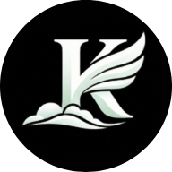

<div align="center">
  
  <h1>Mohd. Faiz Alam — Portfolio</h1>
  <p>
    Personal portfolio of <strong>Mohd. Faiz Alam</strong> — Software Developer, Swing Trader, and Founder of <strong>AgencyGrow</strong>.
  </p>

  
  
  
  
  

  <p>
    <a href="#overview">Overview</a> •
    <a href="#featured-projects">Projects</a> •
    <a href="#tech-stack">Tech Stack</a> •
    <a href="#local-development">Local Setup</a> •
    <a href="#contact">Contact</a>
  </p>
</div>

---

## <a id="overview"></a> Overview

This repository houses my personal portfolio website. It highlights my work across three areas:

- **Software Development**: Web interfaces, interactive simulations, and developer tools built with React, Next.js, TypeScript, Python, and C.
- **Swing Trading**: Market operations structured around volume profiles (POC, value area high/low, high/low volume nodes), liquidity pools, and strict risk-per-trade rules.
- **AgencyGrow**: My advertising agency managing full-funnel Google and Meta campaigns with disciplined budgets and conversion tracking (2–5x ROI).

## <a id="featured-projects"></a> Featured Projects

1. **[BB84 Quantum Key Distribution Simulator](https://github.com/MohammadFaizAlam/faiz-quantum-communication)**
   - Interactive workbench demonstrating quantum key exchange, photon polarization states, basis sifting, One-Time Pad encryption, and eavesdropper detection via Quantum Bit Error Rate (QBER).
   - *Stack*: React, TypeScript, Python, FastAPI, Tailwind CSS.

2. **[Nuvora](https://github.com/MohammadFaizAlam/Nuvora)** ([Live Demo](https://nuvora-media.vercel.app/))
   - Digital storefront and client acquisition platform for my creative and advertising startup, featuring scroll choreography and case-study storytelling.
   - *Stack*: Next.js, React, TypeScript, Framer Motion, GSAP, Locomotive Scroll.

3. **[RL Trading Environment](https://github.com/MohammadFaizAlam/rl-trading-env)**
   - Reinforcement learning workbench for training and evaluating autonomous PPO trading agents on historical and synthetic OHLCV market data using a custom risk-aware Gymnasium environment.
   - *Stack*: Python, FastAPI, Gymnasium, React, TypeScript.

## <a id="tech-stack"></a> Tech Stack & Architecture

- **Framework**: Next.js 16 (App Router) with React 19 and TypeScript
- **Styling**: Tailwind CSS v4 + Radix UI primitives
- **Motion & Physics**: Framer Motion, custom 2D canvas particle field, and pendulum physics (`HangingProfile`)
- **Smooth Scrolling**: Lenis smooth scroll integration
- **Content System**: JSON-driven content and localization under `contents/` and `dictionaries/`

## <a id="local-development"></a> Local Setup

1. **Clone the repository:**

   ```bash
   git clone https://github.com/MohammadFaizAlam/portfolio.git
   cd portfolio
   ```

2. **Install dependencies:**

   ```bash
   npm install
   ```

3. **Run the development server:**

   ```bash
   npm run dev
   ```

   Open [http://localhost:3000](http://localhost:3000) in your browser.

4. **Run content & verification tests:**

   ```bash
   npx tsx --test lib/content-audit.test.ts
   ```

## <a id="contact"></a> Contact

- **Name**: Mohd. Faiz Alam
- **Email**: [faizalam1101@gmail.com](mailto:faizalam1101@gmail.com)
- **Direct Line**: `8591673478`
- **GitHub**: [@MohammadFaizAlam](https://github.com/MohammadFaizAlam)

## License

Licensed under the [MIT License](LICENSE).